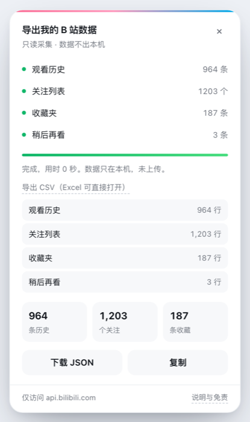

# b-fenxi · B站数据导出器

一个浏览器扩展：把你自己的 B 站**观看历史、关注列表、收藏夹、稍后再看**导出成 JSON 或 CSV 文件。

只读。不点赞、不评论、不关注。没有后端服务器，数据只在你自己的电脑上。

> 起因很简单：B 站只保留约 1200 条观看历史（大概 40 天），年度报告也只给你几个汇总数字。
> 想回看"我这一年到底看了什么"，得自己攒。

<p align="center">
  
</p>

---

## 安装

不需要上架商店，用开发者模式加载：

1. 下载或克隆本仓库
2. 打开 `chrome://extensions/`
3. 右上角打开「开发者模式」
4. 点「加载已解压的扩展程序」，选择本仓库目录
5. 打开任意 B 站页面，右下角会出现「导出我的数据」

Edge 同理：`edge://extensions/`。

---

## 使用

1. 登录 B 站（插件复用你现有的登录态，不需要另外授权）
2. 点右下角悬浮按钮 → 「开始导出」
3. 等 1–3 分钟，看完页面别关
4. 完成后点「下载 JSON」

采集顺序：观看历史 → 关注 → 收藏夹 → 稍后再看。中途可以点「停止」，已采集的部分仍可下载。

导出方式有两种：**JSON**（保留全部字段，适合做分析）和 **CSV**（4 张表，Excel / Numbers 直接打开）。

**中断可续跑。** 每完成一页都会写一次断点（`sessionStorage`）。网络断了、接口报错了、误关了页面，重新打开后按钮会变成「继续导出」，只补没跑完的部分，不会从头再来。

---

## 导出 CSV

完成后点「导出 CSV」，会展开四张表，各自一个文件：

| 文件 | 行数 | 字段 |
|---|---|---|
| `bilibili-history-<日期>.csv` | 观看记录 | 视频ID / 标题 / UP主 / UP主ID / 观看时间 / 时长(秒) / 看到(秒) / **完成度%** / 是否看完 / 分区 |
| `bilibili-followings-<日期>.csv` | 关注 | UID / 昵称 / 签名 / 认证 / 会员 / 关注时间 |
| `bilibili-favorites-<日期>.csv` | 收藏 | **收藏夹** / 视频ID / 标题 / UP主 / UP主ID / 时长(秒) / 收藏时间 / 发布时间 |
| `bilibili-toview-<日期>.csv` | 稍后再看 | 视频ID / 标题 / UP主 / 时长(秒) / 加入时间 / 进度(秒) |

两个细节：

- 文件带 **UTF-8 BOM**，Excel 双击打开中文不会乱码
- 时间统一格式化成 `2026-10-23 10:38:00`，不是 unix 时间戳
- 含逗号、引号、换行的字段按 RFC 4180 转义

「完成度%」是现成算好的：`progress / duration`，标记「已看完」的直接给 100。**这一列是 Excel 里最有用的一列**——按它排序就能看出哪些是点开就走、哪些是真看完了。

## 数据格式

```jsonc
{
  "schemaVersion": 1,
  "generator": "b-fenxi/0.1.0",
  "exportedAt": "2026-10-23T03:14:00.000Z",
  "account": { "mid": 123456, "uname": "你的昵称" },

  "history": [
    {
      "bvid": "BV1xx411c7mD",
      "title": "视频标题",
      "author": "UP 主",
      "author_mid": 384341731,
      "view_at": 1792723132,   // 观看时间（unix 秒）
      "duration": 475,         // 视频总长（秒）
      "progress": 279,         // 看到第几秒；-1 表示已看完
      "tname": "美食记录",      // 分区
      "business": "archive"
    }
  ],

  "followings": [
    {
      "mid": 3493117728656046,
      "uname": "UP 主",
      "sign": "个人签名",
      "official": "bilibili 知名科技UP主",
      "vip": 1,
      "mtime": 1692853122      // 关注时间（unix 秒）
    }
  ],

  "favorites": {
    "默认收藏夹": [
      {
        "bvid": "BV1xx411c7mD",
        "title": "视频标题",
        "upper": "UP 主",
        "upper_mid": 123,
        "duration": 480,
        "fav_time": 1792723132,
        "pubtime": 1700000000
      }
    ]
  },

  "toview": [
    {
      "bvid": "BV1xx411c7mD",
      "title": "视频标题",
      "author": "UP 主",
      "duration": 300,
      "add_at": 1792723132,
      "progress": -1
    }
  ],

  "diag": {
    "history": 964,
    "followings": 1203,
    "favorites": 187,
    "toview": 8,
    "errors": []            // 出错的阶段：[{ phase, code, message }]
  }
}
```

`diag.errors` 记录出错阶段与错误码。常见码的含义与处理见 [STATUS.md](STATUS.md)。

即使有阶段没跑完，也允许先下载已采集的部分——数据不会因为一次失败全丢。

---

## 接口状态

B 站接口随时可能变更。最近一次验证结果、各接口状态和常见错误码见 [STATUS.md](STATUS.md)。

## 已知限制

| 限制 | 原因 |
|---|---|
| 观看历史只有约 1200 条（≈40–50 天） | 平台只保留这么多，超出静默丢弃 |
| 关注列表单次接口最多 1000 条 | 用正序 + 倒序双向抓取补全，通常能拿全 |
| 点赞、投币、评论、弹幕、搜索历史拿不到 | 平台没有对应接口 |
| 收藏的 `fav_time` 可能不准 | 用整理插件重排过收藏夹的账号，时间会被重置 |
| 接口随时可能失效 | 平台接口非公开，变更不通知 |

---

## 隐私

- 所有请求在浏览器内直接发往 `api.bilibili.com`，复用你的登录态
- **不读取、不存储、不上传 Cookie**
- 没有任何后端、没有埋点、没有统计
- 导出的 JSON 存在你本机，包含完整的观看记录，请自行保管

---

## 免责声明

见 [DISCLAIMER.md](DISCLAIMER.md)。

简要：仅供个人备份与分析自己的数据；请自行确认符合平台协议与当地法律；因平台接口变更、风控导致的问题，作者不承担责任。

---

## 开发

```
.
├── manifest.json
├── src/
│   ├── collector.js   # 采集逻辑，纯函数，可单独测试
│   ├── content.js     # 悬浮 UI（Shadow DOM 隔离样式）
│   └── options.html   # 说明页
├── test/
│   └── smoke.mjs      # 冒烟测试：完整采集 / 中断续跑 / 错误码
├── icons/             # 16/32/48/128
├── README.md
├── DISCLAIMER.md
├── STATUS.md
└── LICENSE
```

改动后回到 `chrome://extensions/` 点刷新即可，无需重新加载。

`collector.js` 不依赖 DOM，可以单独在 Node 里跑（需要注入一个 fetch 实现）。

带一个冒烟测试，覆盖完整采集、中断续跑和错误码解释：

```bash
node test/smoke.mjs
```

---

## License

MIT
